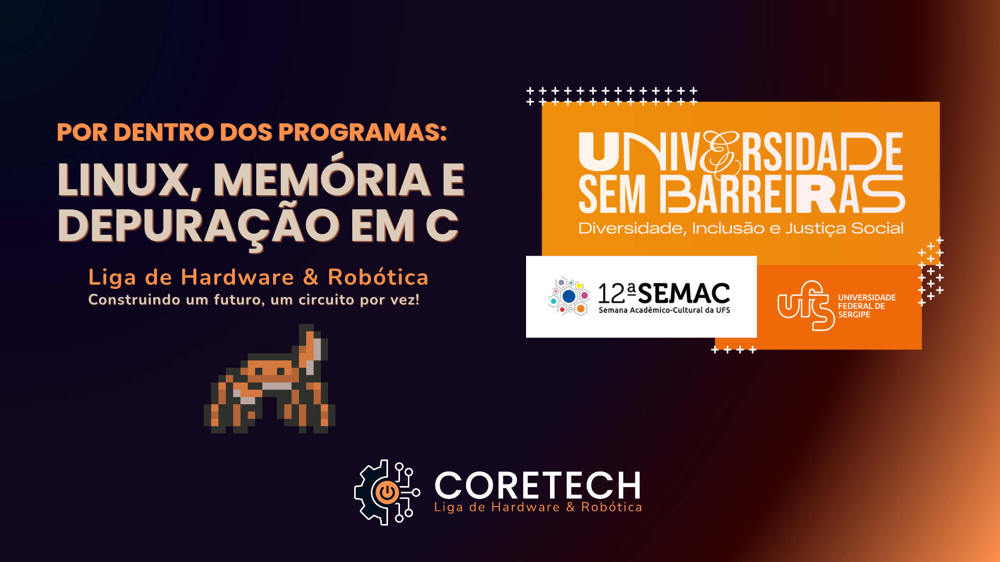
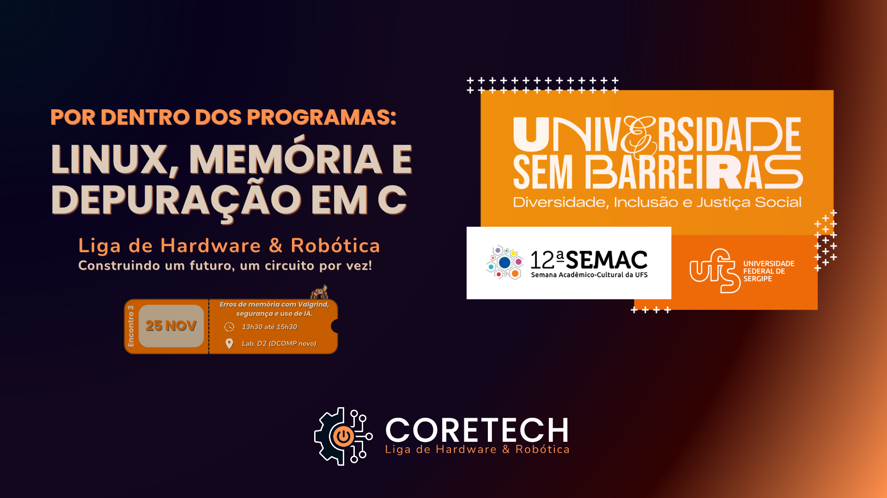

# 12º SEMAC - Por dentro dos Programas: Linux, Memória e Depuração em C

Este repositório contém os códigos-fontes utilizados nas demonstrações e atividades práticas, além dos slides apresentados durante os três dias de Oficina. Sintam-se convidados a utilizá-los para estudo.

<h2>1º Encontro - 23/11/2026</h2>

[Descrição à ser add...]
  
#### Slide utilizado na Apresentação do [Dia 1.](https://canva.link/abkc79dszfpevsp)

 

<h2>2º Encontro 24/11/2026</h2>

[Descrição à ser add...]

 

<h2>3º Encontro 25/11/2026</h2>

[Descrição à ser add...]

 

